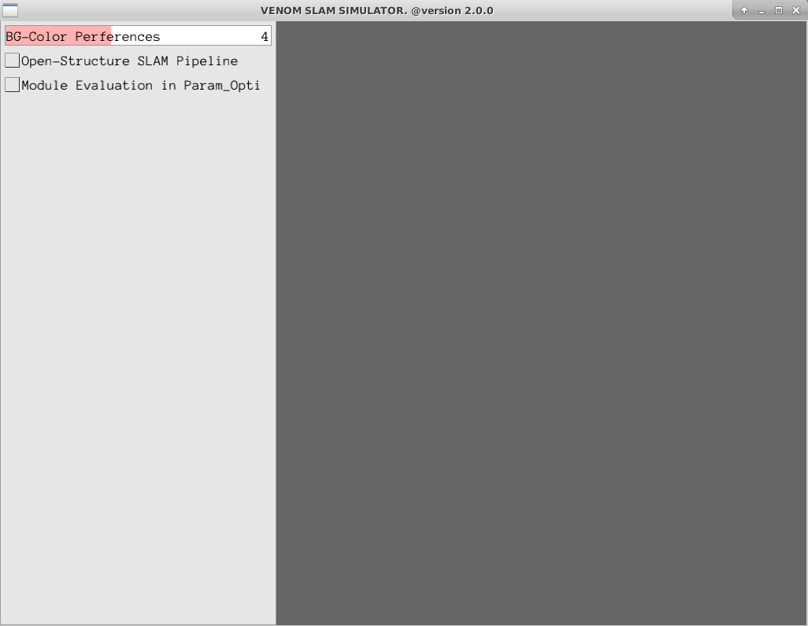
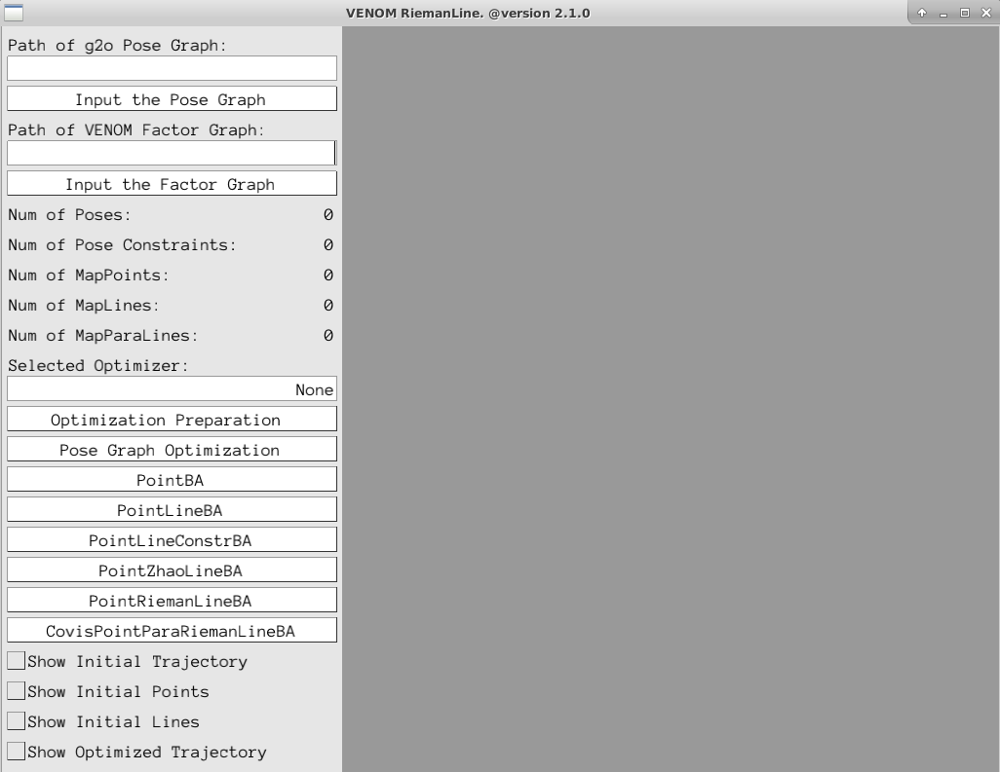
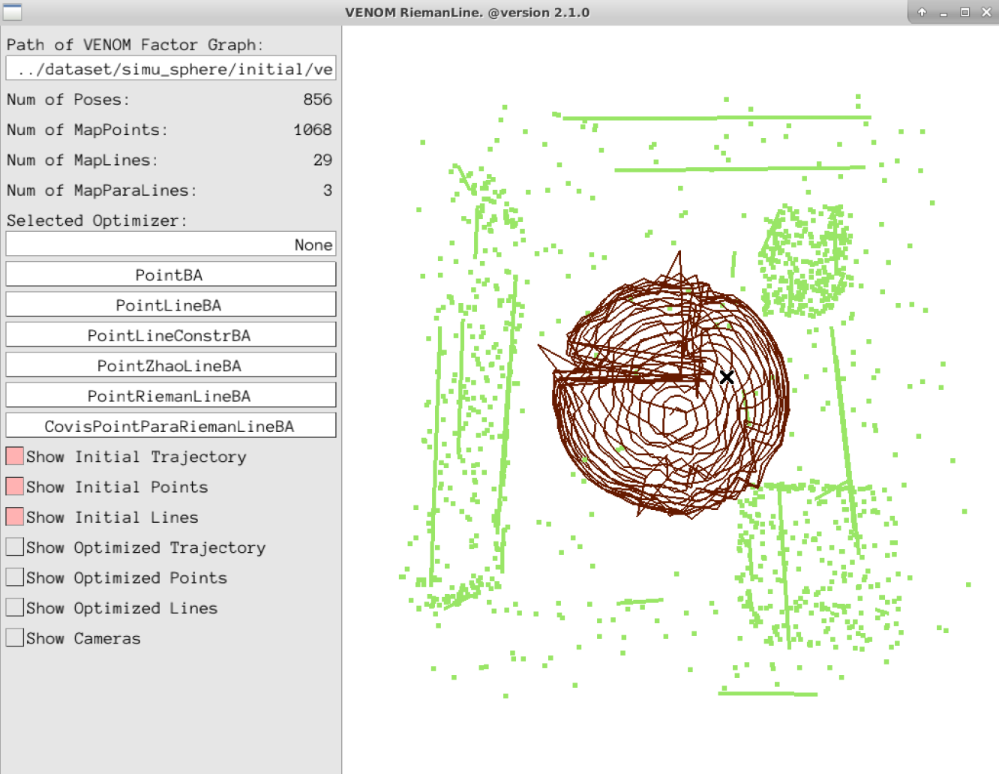
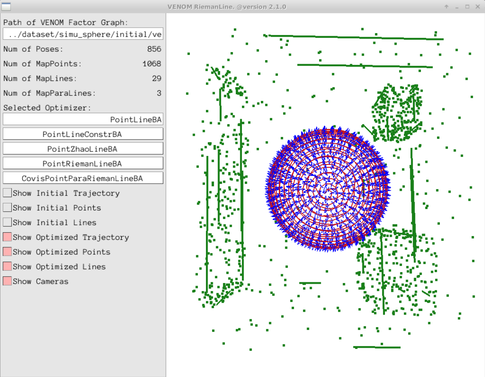
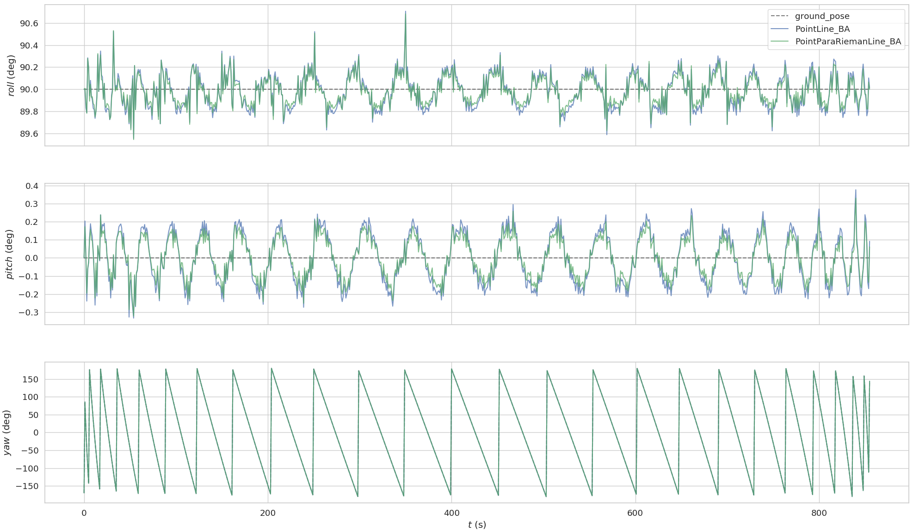
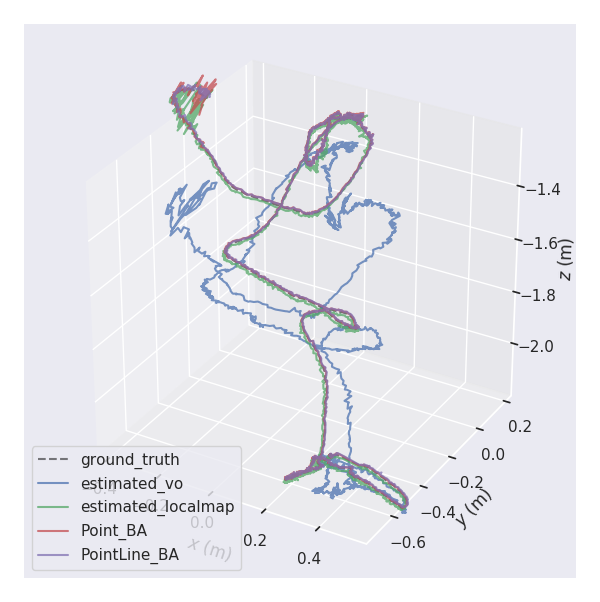
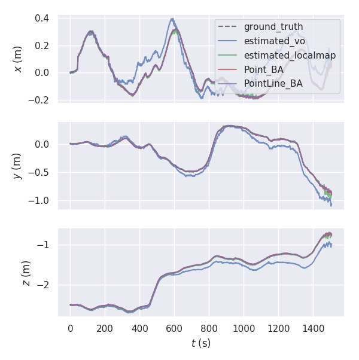
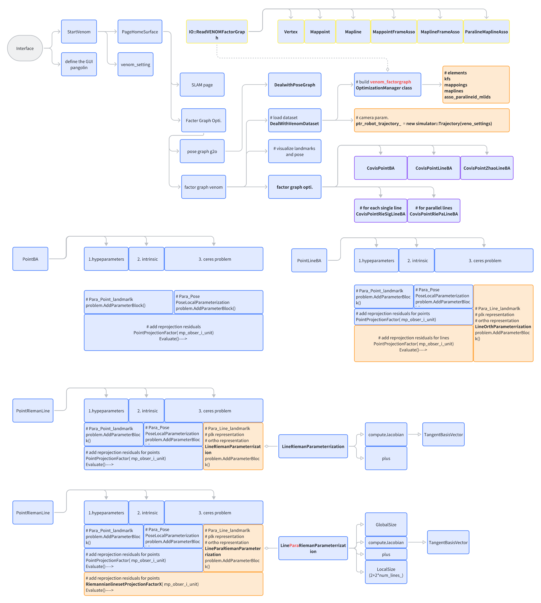

<p align="center">
 <h1 align=""center> RiemanLine: Riemannian Manifold Representation of 3D Lines for Factor Graph Optimization </h1>
</p>

### 1. Motivation

Compared to point landmarks, **lines** and planes exhibit **unique structural properties** that enable them to encode higher-level geometric relationships across views. While point features tend to be isolated and only constrain a few nearby camera poses, **lines inherently capture global scene regularities** through their mutual relationships, such as parallelism and orthogonality.

By leveraging these relationships, **a single line or a group of parallel lines can bridge multiple local observations**, transforming locally constrained landmarks into **global geometric cues** that tightly couple a larger set of camera poses. This capability significantly enhances the overall localization accuracy and consistency of the SLAM system.

Existing representations in robotics and computer vision predominantly handle independent lines, overlooking structural regularities such as sets of parallel lines that are pervasive in man-made
environments. This paper introduces **RiemanLine**, a unified minimal representation for 3D lines formulated on Riemannian manifolds that jointly accommodates both individual lines and parallel-line groups.


### 2. Prerequisites 

We have tested the library in **Ubuntu 18.04**, but it should be easy to compile in other platforms.

#### 2.1 Fast testing based on our Docker image

Clone the repo, and it is easy to build your own image and container based on the dockerfile proposed in the **Docker** folder. The proposed [docker environment](docker/readme.md) contains the following  libs: Pangolin, OpenCV, Eigen and minor supported libraries.   

#### 2.2 Your local environment

The versions of libs used in this project are listed as follows:

```
OPENCV VERSION: 4.5.5
Pangolin VERSION: 0.7
Eigen VERSION: 3.3.4
flags VERSION: 2.2.1
Ceres VERSION: 1.14.0
```


### 3. Start GUI

#### 3.1 Commands

```
git clone git@github.com:yanyan-li/RiemanLine.git
cd RiemanLine
mkdir build 
cd build
cmake ..
make
./bin/start_venom config/config_openstructure_iclnuim.yaml 
```

|           Start           |    Factor Graph Opti.    |
| :-----------------------: | :----------------------: |
|  |  |

#### 3.2 Factor Graph Optimization

**(1) Load initial factor Graph**

The dataset is prepared in [here](dataset/readme.md). 


In the interface of the software, we feed the path of the initial factor graph into the system:  

``` 
../dataset/simu_sphere/initial/venom_sequence.txt
```

|       Initial Graph       |     Optimized Graph      |
| :-----------------------: | :----------------------: |
|  |  |

**(2) Factor graph optimization**

For example, we use the "PointLineBA" for optimization.

```
# docker-terminal
cd RiemanLine/build
../bin/start_venom ../config/config_openstructure_baseline.yaml 
```

```
# in the gui: path of VENOM Factor Graph
../dataset/simu_sphere/initial/venom_sequence.txt
```

```
#### If you want to save the optimization results, make sure the folder exists.
#### The path setting in the your config file:
#### Evaluation.result_path: "../results/baseline_test/"
[Venom Simulator Printer] Saving keyframe trajectory to ../results/baseline_test/PointLine_BA.txt.
[Venom Simulator Printer] Saving mappoints to ../results/baseline_test/PointLine_mappoint.txt.
[Venom Simulator Printer] Saving maplines to ../results/baseline_test/PointLine_mapline.txt.
```


### 4.Evaluation 

Camera poses and landmark positions are recorded by the baseline and can be evaluated by **evo** and our proposed reconstruction error analysis tool. 

```
cd results/baseline_test
evo_traj tum  PointLine_BA.txt PointParaRiemanLine_BA.txt   --ref=ground_pose.txt  -p --plot_mode=xyz
```



```
cd results/icl_test 
evo_traj tum estimated_vo.txt estimated_localmap.txt Point_BA.txt  PointLine_BA.txt  --ref=ground_truth.txt  -p --plot_mode=xyz
```
|       trajectories       |        xyz_view        |                 rpy_view                  |
| :----------------------: | :--------------------: | :---------------------------------------: |
|  |  |  |


### 5. Architecture of the Software

The baseline provides *point-based* and *point-line-based* factor graphs for optimization comparisons and can be easily extended to other parameterizations and factor types.




### 6. License & Citation

This SLAM baseline is designed to read our dataset that directly provides points and lines rather than raw images. The simulator is released under [GNU General Public License v3.0](LICENSE). 

```
@article{li2025riemanline,
  title={RiemanLine: Riemannian Manifold Representation of 3D Lines for Factor Graph Optimization},
  author={Li, Yanyan and Yang, Ze and Tateno, Keisuke and Zhao, Federico Tombari, Liang and Lee, Gim Hee},
  journal={arXiv preprint arXiv:2508.04335},
  year={2025}
}
```

